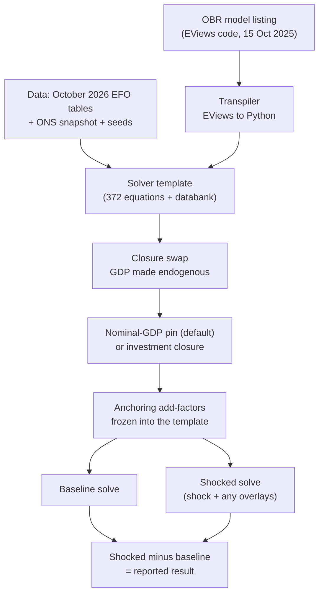

# How it works

This page explains how the repo turns the OBR's published model into a reform result, and what it has to add along the way. The baseline is the OBR's Economic and fiscal outlook (EFO), its twice-yearly forecast; the October 2026 EFO is the current pin. Line numbers such as l.688 refer to lines of the OBR's published model listing. The steps follow the code in [`obr_macro/reform_analysis.py`](https://github.com/PolicyEngine/obr-macroeconomic-model/blob/main/obr_macro/reform_analysis.py) (`run_reform` and `_build_reform_template`) and [`obr_macro/full_solver.py`](https://github.com/PolicyEngine/obr-macroeconomic-model/blob/main/obr_macro/full_solver.py).

## The pipeline at a glance

## 1. Transpiler

The OBR publishes its model as EViews code: 372 equations in a text file. [`obr_macro/transpiler.py`](https://github.com/PolicyEngine/obr-macroeconomic-model/blob/main/obr_macro/transpiler.py) reads each equation and rewrites it as a Python expression. It handles EViews notation such as `dlog(X)` (change in the log), `d(X)` (first difference), lags like `X(-1)`, `@recode` date dummies, `@trend` and `@elem` base-period lookups. Each equation keeps its left-hand side, so the solver knows which variable it determines.

## 2. Solver

[`obr_macro/full_solver.py`](https://github.com/PolicyEngine/obr-macroeconomic-model/blob/main/obr_macro/full_solver.py) holds `FullOBRSolver`. It loads the data and the transpiled equations, fills inputs the OBR does not publish (see [constants](#constants-this-repo-supplies) below), and solves the system one quarter at a time.

Within each quarter it uses **Gauss-Seidel iteration**: evaluate every equation in turn, each one using the latest values of the others, and repeat until no variable moves by more than a relative 1e-6 between passes. If the largest change stops improving for 8 passes, or 60 passes are reached, the quarter exits without converging and `df.attrs["solver_exit_status"]` says so.

Not every equation can run. An equation whose inputs have no data evaluates to NaN and is dropped for that quarter; its variable keeps its data value. In the pinned reform solve over 2025Q1 to 2027Q4, 82 of the 372 equations are dropped in at least one quarter ([Limits](limitations.md)). Each one must be listed in `KNOWN_NONFINITE_EQUATIONS` in `full_solver.py`, or the solve raises an error, so a new silent drop cannot slip in. Several headline variables (investment, trade, prices, earnings) have no live equation and stay at the OBR's values.

## 3. Closure swap: making GDP respond

A **closure** is the choice of which variables the model solves for and which it takes as given.

In the OBR's own file, real GDP (`GDPM`) is an input. Inventories (`DINV`) are the balancing item of the expenditure identity:

`DINV = GDPM + M − SDE − CGG − CONS − VAL − IF − X`

So in the published closure a demand shock moves inventories, not GDP. To let a shock move GDP, `swap_closure` deletes that `DINV` equation, holds `DINV` at its EFO path, and adds the identity

`GDPM = CGG + CONS + IF + DINV + VAL + X − M + SDE`

so GDP becomes the variable the identity solves for. This is the repo's main departure from how the OBR runs the model.

## 4. Nominal GDP: the default pin

The published code defines current-price GDP (`GDPMPS`) and the investment deflator (`PIF`) with what is really one identity written twice (l.337 and l.688). An iterative solve then leaves `PIF` wherever its starting value puts it, and under that closure no quarter converges.

By default `run_reform` replaces l.688 with the OBR's own commented-out l.690:

`GDPMPS = PGDP × GDPM / 100`

The GDP deflator `PGDP` is held at its EFO path, as it is anyway, so this adds no new assumption about prices; it removes the free `PIF`. Under the pin every quarter converges. `nominal_gdp_pin=False` returns to the published closure. Full detail: [nominal-GDP pin](nominal_gdp_pin.md).

## 5. Anchoring add-factors

An **add-factor** is a residual added to an equation so that it reproduces a chosen path. The OBR uses add-factors to impose its judgement on the model.

Here, for each behavioural equation from 2024Q1 (those driven by date dummies or trends are left out), the solver computes the gap between the EFO value and what the equation predicts (EFO minus model). Before a reform is run, `freeze_anchoring` turns these gaps into fixed add-factors, expressed in each equation's own form (for example on the log change for a `dlog` equation). Two level identities that have no residual of their own, household disposable income `HHDI` and, under the investment closure, total investment `IF`, get a held level add-factor instead.

The add-factors are applied identically in the baseline and the shocked run. They set the level of both onto the EFO, and they cancel when one is subtracted from the other. They change the starting point of a reform, not its effect. The resulting reform baseline tracks the EFO closely ([Limits](limitations.md) has the figures); that fit holds by construction and says nothing about forecast skill.

## 6. Deviation mode: baseline against shocked

`run_reform` builds one template (closures swapped, add-factors frozen, unsolved) and caches it. It then makes two identical copies:

- the **baseline**, solved as it is;
- the **shocked** copy, with the shock added to `var` (and any overlay applied), then solved.

The reported result is shocked minus baseline, quarter by quarter. Because the two copies differ only by the shock, anything common to both, including the add-factors and seeded constants, drops out. The template is reused by later calls with the same structure, which is why the first call is the slow one.

### Free-running versus anchored

With the add-factors switched off, the model runs free from its own equations. Its free-running gap from the EFO (GDP 4.24% mean absolute error over 2025Q1 to 2027Q4, [Limits](limitations.md)) measures **this emulator**: the closure swap above plus the OBR inputs and constants that had to be pulled from the ONS or seeded. It says nothing about the OBR's forecasting accuracy: in the OBR's own model GDP is an input, so their model cannot miss it. Reforms are never scored around the free-running model. See the [calibration scorecard](calibration_scorecard.md).

## The investment closure

In the published listing business investment is a residual, and total investment `IF` has no live equation. So a corporation tax change cannot reach investment, and government investment cannot reach GDP.

`investment_closure=True` changes that:

- it switches on the business-investment equation `dlog(IBUSX)`, which the OBR publishes commented out and one bracket short; the repo restores the bracket where the OBR's 2013 briefing paper places it;
- it switches on the listing's commented-out identity `IF = IBUS + GGI + PCIH + PCLEB + IH + IPRL` (l.86).

Run as published, that equation sits inside an explosive loop on this data: a zero-shock baseline runs business investment from £86bn in 2025Q1 to £522bn in 2027Q4 with the nominal-GDP pin, or £586bn under the published closure ([Limits](limitations.md), measured 15 Nov 2026 on the March 2026 EFO; reproduce with [`scripts/unguarded_ibusx.py`](https://github.com/PolicyEngine/obr-macroeconomic-model/blob/main/scripts/unguarded_ibusx.py)). To keep it stable the closure:

- freezes market-sector output `MSGVA`, the investment deflator `PIF` and household property income `PIRHH` at a reference path from a solve in which business investment is held on the OBR's path;
- anchors `dlog(IBUSX)` to the OBR's path with add-factors in log space, so the equation's own error-correction term gives the base-against-shock deviation a steady state.

Both are applied identically to baseline and shocked runs. The closure also caps Gauss-Seidel at 25 passes a quarter and cannot be combined with the nominal-GDP pin, because it already determines nominal GDP by holding `PIF`. It is a stop-gap for the missing supply-side calibration. A 12-quarter result is about 40% of the way to its long-run level; `df.attrs["investment_closure_plateau_fraction"]` reports where each run sits.

## Constants this repo supplies

Four constants set the whole size of the corporation tax to investment response. The OBR publishes their equations but not the inputs those equations need (`DISCO`, `IIB`, `SIB`, `FP`, `SP`, `SV`, `DELTA` and `RWACC` have no equation and no data in any published file). So the published equations always evaluate to NaN and are dropped, and the seeded values below are the values used for the whole run, not starting guesses.

Since 2026-08 the three present values of capital allowances are estimated from published sources: statutory capital-allowance rates and the OBR's own EFO long-gilt assumption, run through the OBR's published formulas. The derivation is in [`obr_macro/cost_of_capital.py`](https://github.com/PolicyEngine/obr-macroeconomic-model/blob/main/obr_macro/cost_of_capital.py) (reproduce with `python -m obr_macro.cost_of_capital`).

| Constant | Now | Was | Basis |
|---|--:|--:|---|
| `DB`, present value of allowances, buildings | 0.0 | 0.18 | The OBR's own equation sets it to zero after 2011Q2 (Industrial Buildings Allowance abolished April 2011). No unpublished input needed. |
| `DP`, present value of allowances, plant | 0.9492 | 0.06 | Full expensing (100% first-year allowance, permanent since Finance Act 2024) reduces the formula to `1/(1+DISCO)`. `DISCO` = 0.0535, the mean October 2026 EFO 20-year gilt yield over the solve window. |
| `DV`, present value of allowances, vehicles | 0.7709 | 0.25 | `SV/(DISCO+SV)` with the statutory 18% main-rate writing-down allowance. |
| `COCU`, pre-tax user cost of capital | 0.12 | 0.12 | Kept as a declared seed. Its level cancels in the corporation tax deviation (doubling it moves a 12-quarter `delta_IF` path by less than 1e-10), and its equation needs a 1970Q1 rebasing anchor older than every committed series, so no estimate can be shown better. |

The old `DB`, `DP` and `DV` values were statutory writing-down rates entered as present values, with the asset classes swapped (the OBR's variables workbook defines `DB` as buildings, `DP` as plant, `DV` as vehicles). That overstated the corporation tax response roughly 2.4 times. The seeds live in `full_solver.UNPUBLISHED_COST_OF_CAPITAL_SEEDS` and are pinned to their derivation by `tests/test_calibration_constants.py`. They are estimated, not fitted: no attempt is made to tune them so a costing hits a target.

Two more level anchors matter. Both are tied to published data and apply identically to the baseline and every shocked run, so they cancel in a result, but both are large:

- **`OSHH` add-factor.** Households' operating surplus carries an add-factor of about £41bn against a level of about £79bn, so 55% of the series is the add-factor. The OBR's base constant (12874) and its vintage of the rent series `PRENT` are unpublished. The add-factor is fitted to the ONS series over history and held flat at the mean of the last four observed quarters for the forecast.
- **`GGVA` seed.** Government value added is seeded at 20% of GDP, an uncited round number. The published equation is a ratio (`GGVA/GGVA(-1) = CGG/CGG(-1)`), so it inherits whatever level the seed sets. That level then determines market-sector output `MSGVA = GVA − GGVA`, which drives the investment equation.

## Known inert equations

`log(HHTFA)` and `log(NDIVHH)` now parse correctly; before, they had no left-hand-side handling at all. Both still stay frozen, because their inputs `MAJGDP` and `CORP` are missing from the published databank. So the channel from company profits to household dividend income (`FYCPR → NDIVHH → PIRHH → HHDI`) is still inert. See [forecasting framework](forecasting_framework.md).

## Module map

One line per file in [`obr_macro/`](https://github.com/PolicyEngine/obr-macroeconomic-model/tree/main/obr_macro), from each module's docstring.

| Module | What it does |
|---|---|
| `__init__.py` | Package entry point; exports `run_reform`, `run_five_reforms`, `FullOBRSolver`, `load_obr_data`, `parse_model_file`, `ParsedEquation` and `DATA_DIR`. |
| `transpiler.py` | Converts the OBR's EViews equations into Python expressions (`parse_model_file`, `EViewsTranspiler`). |
| `full_solver.py` | `FullOBRSolver`: loads data and equations, seeds missing constants, computes residuals, and solves quarter by quarter with Gauss-Seidel; also closure swaps, shocks and the dropped-equation guard. |
| `reform_analysis.py` | `run_reform` and `run_five_reforms`: builds the reform template (closures, pin, investment closure, anchoring), runs baseline and shocked solves, labels the result, and draws the standard charts. |
| `data.py` | Loads the EFO workbooks into one quarterly databank, merges the ONS snapshot and derives extra variables (`load_obr_data`). |
| `baseline.py` | Builds the forward baseline over the projection horizon, anchored to the EFO or free-running. |
| `forecast.py` | Held-add-factor forecasting: add-factors averaged over a base window and held constant while the model projects forward. |
| `forecast_tune.py` | Sweeps add-factor windows and the investment closure to tune the held-add-factor forecast for the weakest channels. |
| `calibration_score.py` | The raw-model calibration scorecard: free-running model against the EFO (`python -m obr_macro.calibration_score`). |
| `scoring.py` | Shared error metrics and bands for the forecast and calibration scorecards. |
| `cost_of_capital.py` | Derives `DB`, `DP` and `DV` from statute and the EFO gilt assumption. |
| `published_conventions.py` | The OBR's published fiscal-multiplier conventions, encoded as data for `published_conventions=True`. |
| `demand_overlays.py` | The opt-in import and employment overlays. |
| `debt_interest.py` | The opt-in debt-interest overlay. |
| `transmission_audit.py` | Shocks each main lever and classifies each channel as transmitting, identity-only or dead. |
| `ons_fetch.py` | Fetches one ONS time series by its CDID code and converts it to quarterly. |
| `ons_pull.py` | Pulls every ONS input the model needs into the committed snapshot in `obr_macro/seeds/`. |

The data files are described on [data and results](data.md).
