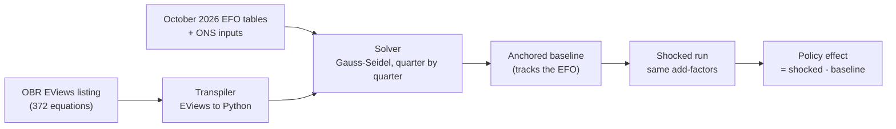

# OBR macroeconomic model in Python

PolicyEngine's open Python replication of the macroeconomic model that the Office for Budget Responsibility (OBR) publishes. It reads the OBR's own EViews listing, translates every equation into Python, solves the system quarter by quarter, and lets you shock a policy instrument to see how GDP, consumption, investment, household income and the public finances respond.

It is a research and teaching tool. It is not the OBR's forecast and it does not reproduce the OBR's judgements.

!!! warning "Read the limits before quoting a number"
    - **The baseline matches the OBR's forecast by construction.** Add-factors (adjustments added to each equation so it reproduces the OBR's path) are computed as forecast minus model. A close fit proves the anchoring works, not that the model forecasts well.
    - **Without the add-factors the model drifts.** GDP is 4.24% off the October 2026 Economic and Fiscal Outlook (EFO) path on average. That gap belongs to this emulator, not to the OBR: in the OBR's model GDP is an input, so it cannot miss it.
    - **Several channels are accounting, not behaviour.** The government-consumption multiplier is about 1.0 against the OBR's 0.6. Government investment does not reach GDP under the default set-up. Prices, unemployment and debt interest do not respond unless you switch on a labelled overlay.
    - **Every result is a point estimate.** There are no uncertainty bands.

    The full list, channel by channel, is on [Limits](limitations.md).

## What it does



- Parses all 372 equations in the OBR's published listing (15 October 2025 version). In the default reform window, 82 of them cannot be evaluated in at least one quarter because an input has no published data; each is listed and checked.
- Makes GDP respond to demand by swapping the OBR's closure: the OBR solves for inventories with GDP as an input; here GDP is solved from the expenditure identity.
- Scores a reform as the difference between an anchored baseline and a shocked run, so the add-factors set the level and cancel in the difference.
- Offers opt-in, labelled overlays where the published equations are silent: the OBR's published multipliers, price pass-through of indirect taxes, mortgage-rate pass-through of Bank Rate, import leakage, an employment response and debt interest. All are off by default.

## Where to go next

| If you want to | Read |
|---|---|
| Install it and run a first reform | [Getting started](getting-started.md) |
| Understand the pipeline and the choices behind it | [How it works](how-it-works.md) |
| See every `run_reform` option and overlay | [Options and overlays](options.md) |
| Copy a worked example for a policy channel | [Worked examples](examples.md) |
| Know what not to quote | [Limits](limitations.md) |
| Check how it is tested and validated | [Testing](testing.md), [Calibration scorecard](calibration_scorecard.md), [Review of the published model](published_model_review.md) |
| Find the data, pins and result files | [Data and results](data.md) |
| See why a modelling choice was made | [Modelling decisions](decisions.md) |
| Look up a function | [API reference](api.md) |

## Quick example

```python
from obr_macro import run_reform

# Government consumption +£1.25bn a quarter for four quarters
df = run_reform(name="Spending rise", var="CGG", shock=1250, periods=4)
print(df[["period", "delta_gdp_bn", "pct_gdp"]])
```

The first call builds the model template and takes a few minutes. See [Getting started](getting-started.md) for what the output columns mean.

## Source, licence and citation

- Code: [github.com/PolicyEngine/obr-macroeconomic-model](https://github.com/PolicyEngine/obr-macroeconomic-model), MIT licence.
- Text and figures: CC BY 4.0, with attribution to PolicyEngine.
- The OBR's model listing, variable list and forecast tables are the OBR's and keep their own terms.
- Changes are recorded one per file in [`changelog.d/`](https://github.com/PolicyEngine/obr-macroeconomic-model/tree/main/changelog.d).
