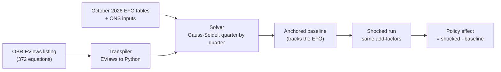

<div class="pe-hero" markdown>

# :material-chart-timeline-variant: OBR macroeconomic model in Python { .pe-hero-title }

PolicyEngine's open Python replication of the macroeconomic model that the Office for Budget Responsibility (OBR) publishes. It reads the OBR's own EViews listing, translates every equation into Python, solves the system quarter by quarter, and shows how GDP, consumption, investment, household income and the public finances respond to a policy change.
{ .pe-hero-lede }

[:material-rocket-launch: Get started](getting-started.md){ .md-button .md-button--primary }
[:material-lightbulb-on: Worked examples](examples.md){ .md-button }
[:fontawesome-brands-github: Source code](https://github.com/PolicyEngine/obr-macroeconomic-model){ .md-button }

</div>

<div class="grid cards pe-stats" markdown>

-   :material-function-variant:{ .lg .middle } **372 equations**

    Every equation in the OBR's October 2025 listing, parsed and solved.

-   :material-calendar-range:{ .lg .middle } **October 2026 EFO**

    The baseline is anchored to the OBR's latest Economic and Fiscal Outlook.

-   :material-layers-triple:{ .lg .middle } **6 opt-in overlays**

    Labelled judgement where the published equations are silent, off by default.

-   :material-test-tube:{ .lg .middle } **Tested on every change**

    Fast tests on every pull request; full-solve invariants on main, nightly and weekly.

</div>

!!! warning "Read the limits before quoting a number"

    - :material-target-variant: **The baseline matches the OBR's forecast by construction.** Add-factors (adjustments added to each equation so it reproduces the OBR's path) are computed as forecast minus model. A close fit proves the anchoring works, not that the model forecasts well.
    - :material-trending-down: **Without the add-factors the model drifts.** GDP is 4.24% off the October 2026 EFO path on average. That gap belongs to this emulator, not to the OBR: in the OBR's model GDP is an input, so it cannot miss it.
    - :material-calculator-variant: **Several channels are accounting, not behaviour.** The government-consumption multiplier is about 1.0 against the OBR's 0.6. Government investment does not reach GDP under the default set-up. Prices, unemployment and debt interest respond only with a labelled overlay.
    - :material-chart-bell-curve: **Every result is a point estimate.** There are no uncertainty bands.

    [:material-alert-octagon: The full list, channel by channel](limitations.md)

## :material-cogs: What it does { #what-it-does }



<div class="grid cards" markdown>

-   :material-code-braces:{ .lg .middle } **Translate**

    ---

    Parses the OBR's published EViews code into Python. In the default window, 82 equations lack an input in at least one quarter; each is listed and checked.

-   :material-swap-horizontal-bold:{ .lg .middle } **Close**

    ---

    Swaps the OBR's closure so GDP responds to demand: the OBR solves for inventories with GDP as an input, here GDP comes from the expenditure identity.

-   :material-anchor:{ .lg .middle } **Anchor**

    ---

    Add-factors make the baseline track the EFO. The same add-factors go into the shocked run, so they cancel in the policy effect.

-   :material-tune-variant:{ .lg .middle } **Extend, if you choose**

    ---

    Opt-in overlays for published multipliers, price pass-through, mortgage rates, imports, employment and debt interest.

</div>

## :material-compass: Where to go next { #where-to-go-next }

<div class="grid cards" markdown>

-   :material-rocket-launch:{ .lg .middle } __Getting started__

    ---

    Install it, run a first reform and read the output.

    [:octicons-arrow-right-24: Getting started](getting-started.md)

-   :material-cog-transfer:{ .lg .middle } __How it works__

    ---

    The pipeline from the OBR's listing to a scored reform, and the choices behind it.

    [:octicons-arrow-right-24: How it works](how-it-works.md)

-   :material-tune-variant:{ .lg .middle } __Options and overlays__

    ---

    Every `run_reform` argument, its default and what it changes.

    [:octicons-arrow-right-24: Options](options.md)

-   :material-lightbulb-on:{ .lg .middle } __Worked examples__

    ---

    One per policy channel, with the sign convention and sourced numbers.

    [:octicons-arrow-right-24: Examples](examples.md)

-   :material-alert-octagon:{ .lg .middle } __Limits__

    ---

    What not to quote, and why.

    [:octicons-arrow-right-24: Limits](limitations.md)

-   :material-test-tube:{ .lg .middle } __Testing and validation__

    ---

    The test suite, the calibration scorecard and a line-by-line review of the published model.

    [:octicons-arrow-right-24: Testing](testing.md)

-   :material-database:{ .lg .middle } __Data and results__

    ---

    The data shipped, the version pins and the committed result files.

    [:octicons-arrow-right-24: Data](data.md)

-   :material-api:{ .lg .middle } __API reference__

    ---

    Functions and classes, generated from the code.

    [:octicons-arrow-right-24: API](api.md)

</div>

## :material-code-tags: Quick example { #quick-example }

=== ":material-language-python: Python"

    ```python
    from obr_macro import run_reform

    # Government consumption +£1.25bn a quarter for four quarters
    df = run_reform(name="Spending rise", var="CGG", shock=1250, periods=4)
    print(df[["period", "delta_gdp_bn", "pct_gdp"]])
    ```

=== ":material-console: Install"

    ```bash
    git clone https://github.com/PolicyEngine/obr-macroeconomic-model.git
    cd obr-macroeconomic-model
    uv sync
    ```

:material-timer-sand: The first call builds the model template and takes about 10 seconds. See [Getting started](getting-started.md) for what the output columns mean.

## :material-scale-balance: Source, licence and citation { #source-licence-and-citation }

- :fontawesome-brands-github: Code: [github.com/PolicyEngine/obr-macroeconomic-model](https://github.com/PolicyEngine/obr-macroeconomic-model), MIT licence.
- :material-creative-commons: Text and figures: CC BY 4.0, with attribution to PolicyEngine.
- :material-bank-outline: The OBR's model listing, variable list and forecast tables are the OBR's and keep their own terms.
- :material-history: Changes are recorded one per file in [`changelog.d/`](https://github.com/PolicyEngine/obr-macroeconomic-model/tree/main/changelog.d).
